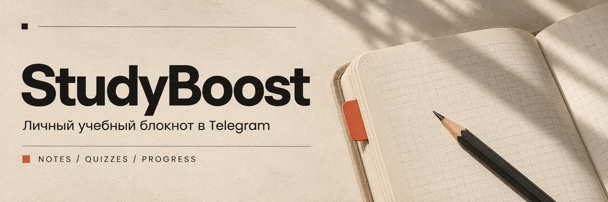
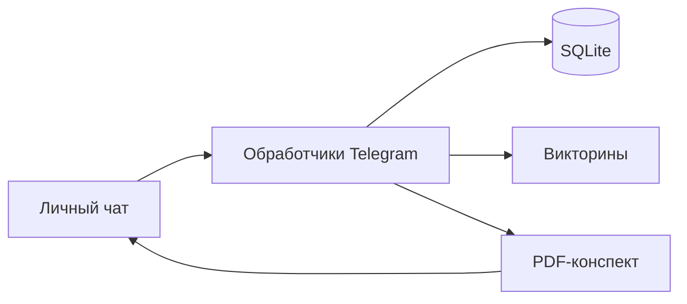

<p align="center">
  
</p>

<p align="center">
  <a href="https://www.python.org/"></a>
  <a href="https://docs.python-telegram-bot.org/"></a>
  
  <a href="SECURITY.md"></a>
</p>

<p align="center">
  <b>Твой учебный блокнот прямо в Telegram.</b><br>
  Заметки по предметам, короткие викторины и конспекты в PDF.
</p>

<p align="center">
  <a href="#возможности">Возможности</a> ·
  <a href="#быстрый-старт">Быстрый старт</a> ·
  <a href="#как-пользоваться">Как пользоваться</a> ·
  <a href="SECURITY.md">Безопасность</a>
</p>

---

## Возможности

| Инструмент | Что можно делать |
| --- | --- |
| Заметки | Сохранять текст, фото и голосовые сообщения |
| Предметы и теги | Выбирать категорию, добавлять #теги и просматривать свои заметки |
| PDF-конспект | Экспортировать текст заметок, подписи к фото и сведения о голосовых |
| Викторины | Отвечать на вопросы по математике, физике, химии и информатике |
| Мотивация | Получать баллы, открывать уровни и достижения |
| Статистика | Видеть количество заметок, результаты викторин и серию активности |
| Совет дня | Получать учебную подсказку и ежедневный бонус |

Бот работает в личных чатах. Фото и голосовые сохраняются как ссылки на файлы
Telegram: PDF содержит подписи и сведения о вложениях, без распознавания содержимого.
Облачной синхронизации и автоматических напоминаний в этой версии нет.

## Быстрый старт

Нужны Python 3.11+, Git и токен бота от [@BotFather](https://t.me/BotFather).
Если токен уже публиковался, сначала отзови его и получи новый.

### 1. Подготовь окружение

```bash
git clone https://github.com/isazhannnn/studyboost-bot.git
cd studyboost-bot
python -m venv .venv
```

Windows PowerShell:

```powershell
.\.venv\Scripts\python.exe -m pip install -r requirements.txt
```

macOS / Linux:

```bash
.venv/bin/python -m pip install -r requirements.txt
```

### 2. Укажи токен локально

Скопируй `config.json.example` в `config.json` и замени
`YOUR_BOT_TOKEN_HERE` на новый токен. Файл исключён из Git.

Вместо файла можно задать переменную окружения `BOT_TOKEN` в настройках
хостинга или локального процесса. Она имеет приоритет над файлом.
Не вставляй рабочий токен в исходники, команды, попадающие в общие журналы,
или скриншоты. Файлы `.env` автоматически не загружаются.

| Настройка | Значение по умолчанию | Назначение |
| --- | --- | --- |
| `BOT_TOKEN` | Нет | Токен Telegram-бота; обязателен |
| `STUDYBOOST_DB` | `studyboost.db` | Путь к базе SQLite |
| `config.json → database.name` | `studyboost.db` | Путь к БД, если переменная не задана |

Для вложенного пути к БД заранее создай родительскую папку.
Относительные пути вычисляются от папки проекта.

### 3. Запусти бота

Windows:

```powershell
.\.venv\Scripts\python.exe run.py
```

macOS / Linux:

```bash
.venv/bin/python run.py
```

Открой своего бота в Telegram и отправь `/start`.
Для остановки нажми `Ctrl+C`. Одновременно запускай один polling-процесс.

## Как пользоваться

1. Нажми **«Добавить заметку»** и выбери предмет.
2. Отправь текст, фото или голос. В тексте и подписи можно использовать #теги.
3. Открой **«Мои заметки»** и выбери категорию.
4. Создай PDF-конспект или пройди викторину из главного меню.

| Команда | Действие |
| --- | --- |
| `/start` | Открыть главное меню |
| `/help` | Посмотреть справку |
| `/stats` | Открыть личную статистику |
| `/goals` | Посмотреть цели и прогресс |
| `/goal Текст цели` | Добавить цель |
| `/privacy` | Посмотреть сведения о хранении данных |
| `/delete_me` | Удалить свои данные после подтверждения |
| `/cancel` | Отменить текущий ввод и очистить состояние викторины |

За заметку начисляется **5 баллов**, за правильный ответ — **10**,
за первое чтение совета в день — **2**. Достижения дают дополнительные бонусы.
Серия активности и ежедневный бонус учитываются по UTC.

### PDF и кириллица

Генератор ищет шрифт с кириллицей: локальный `DejaVuSans.ttf`, затем системные
DejaVu Sans или Arial. Можно задать путь через `STUDYBOOST_FONT`. Если шрифт
не найден, экспорт попросит установить его вместо создания нечитаемого файла.
После отправки бот удаляет созданный PDF с диска.

## Устройство проекта



```text
studyboost-bot/
├── run.py                 # Конфигурация и запуск
├── studyboost_bot.py       # Меню, диалоги и обработчики
├── database.py            # SQLite: пользователи, заметки, статистика
├── gamification.py        # Баллы, уровни и достижения
├── quiz_system.py         # Вопросы и проверка ответов
├── pdf_generator.py       # Экспорт конспектов
├── cloud_sync.py          # Отключённый интерфейс будущих интеграций
├── config.json.example    # Шаблон без секретов
├── tests/                 # Регрессионные проверки
└── SECURITY.md            # Секреты и действия при утечке
```

## Разработка

Проверки выполняются без рабочего токена и без запросов к Telegram:

```bash
python -m unittest discover -s tests -v
python -m compileall -q .
```

GitHub Actions запускает тесты на Python 3.11 и 3.13, а также проверяет,
что конфигурация, личные данные и распознаваемые токены не попали в отслеживаемые файлы.
Проверка токенов: `python tools/check_secrets.py`. Она проверяет текущие файлы,
а не старые коммиты.

Перед обновлением работающего экземпляра сделай локальную резервную копию
SQLite при остановленном боте. Не загружай её в репозиторий.
После перезапуска незавершённые диалоги нужно начать заново.

## Дальнейшее развитие

- [ ] Расписание и напоминания с выбором часового пояса.
- [ ] Полноценный OAuth для облачного хранения.
- [ ] Поиск и постраничный просмотр большого числа заметок.
- [ ] Удаление личных данных с подтверждением.

Нашёл ошибку? Создай [Issue](https://github.com/isazhannnn/studyboost-bot/issues)
с шагами воспроизведения, без токенов и личных заметок.
